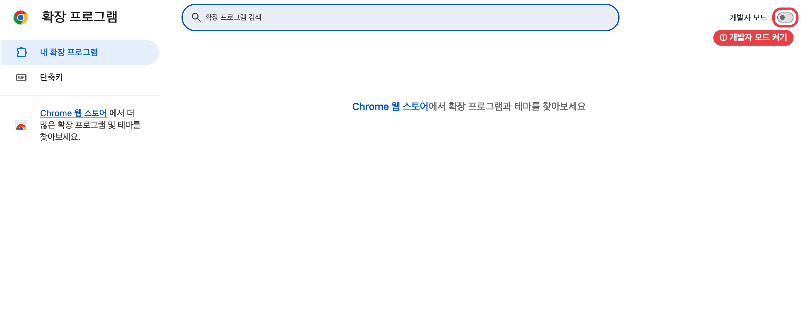
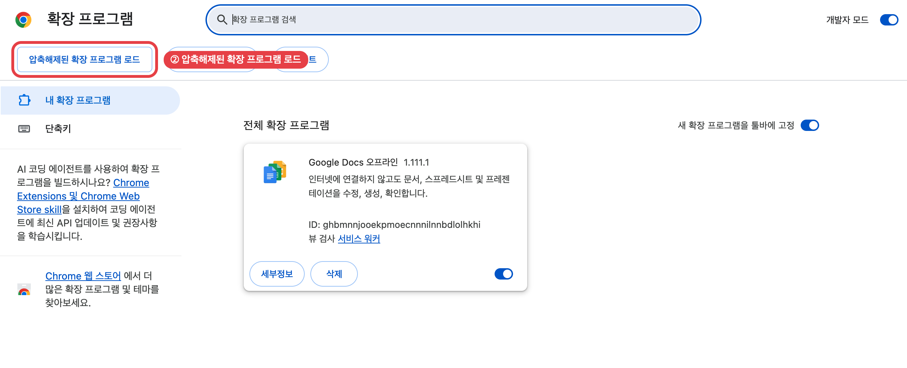
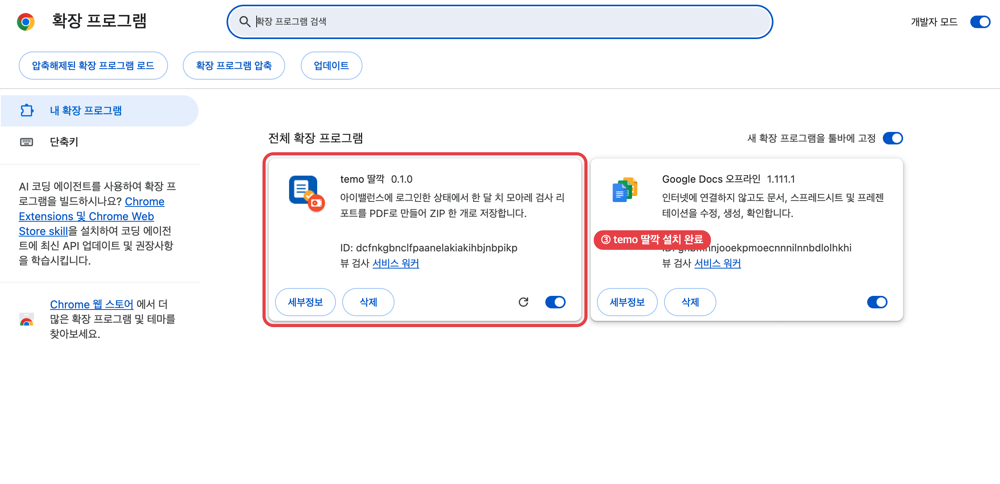
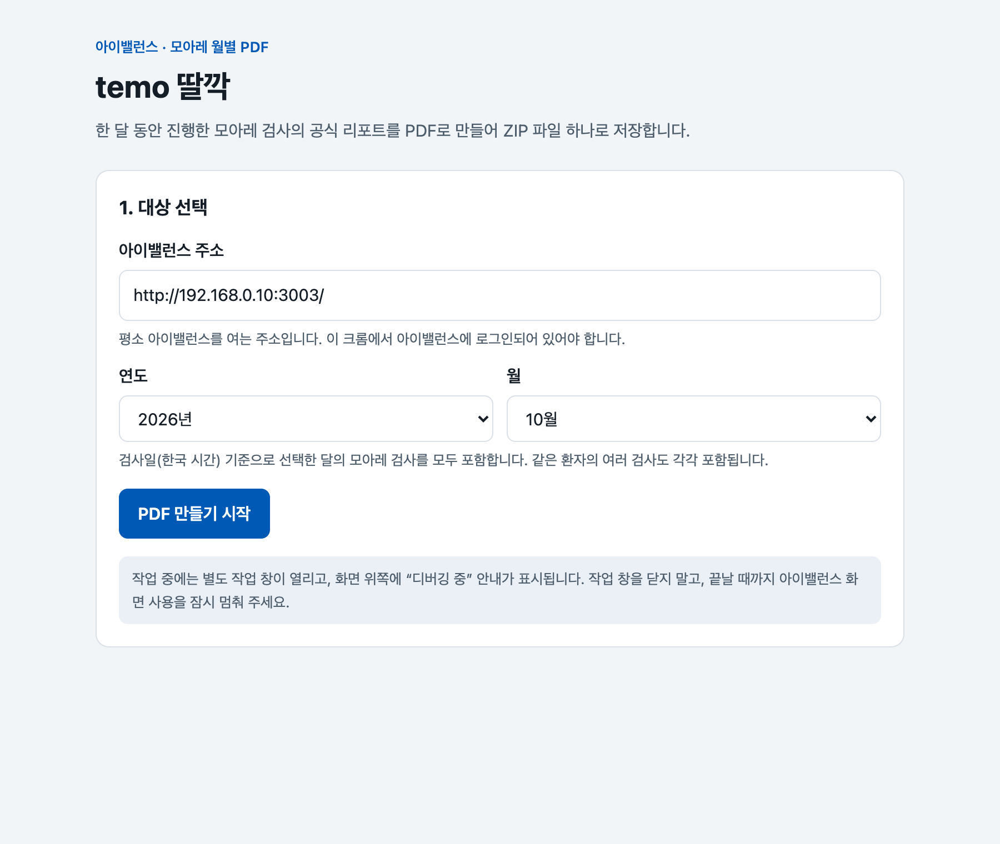
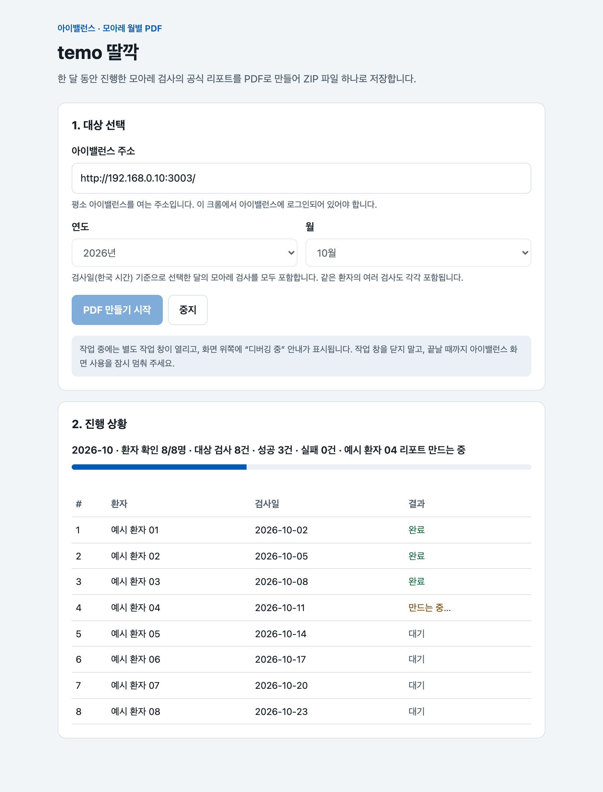
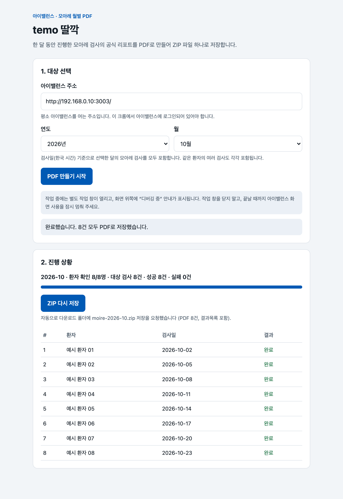
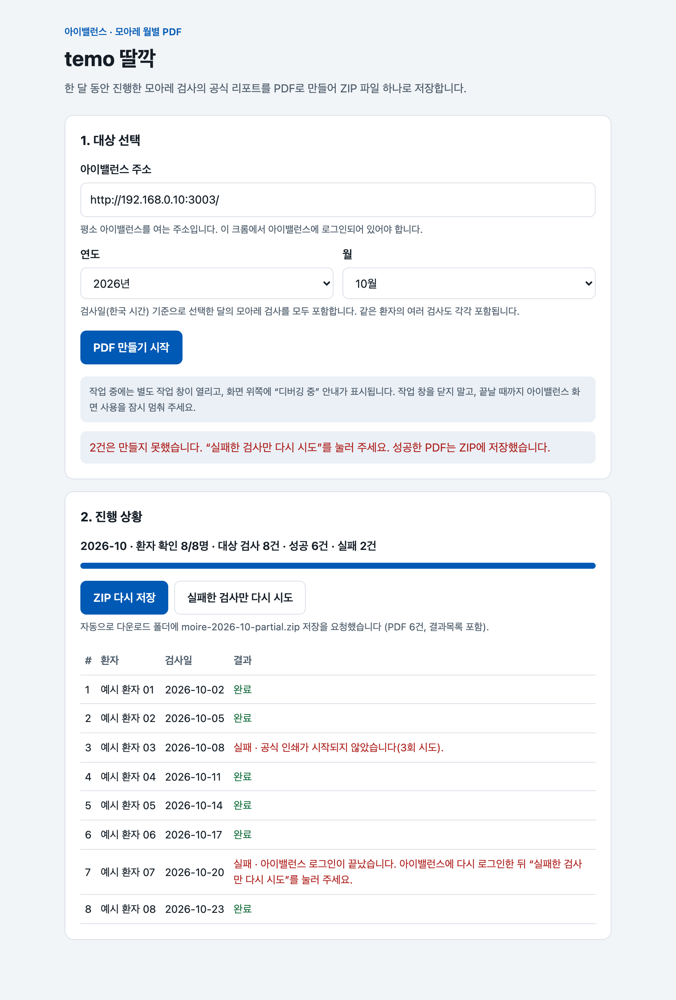
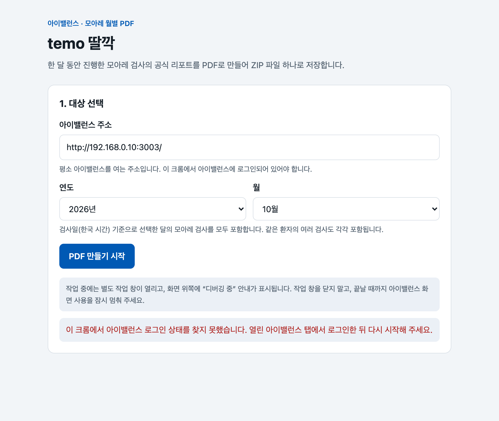
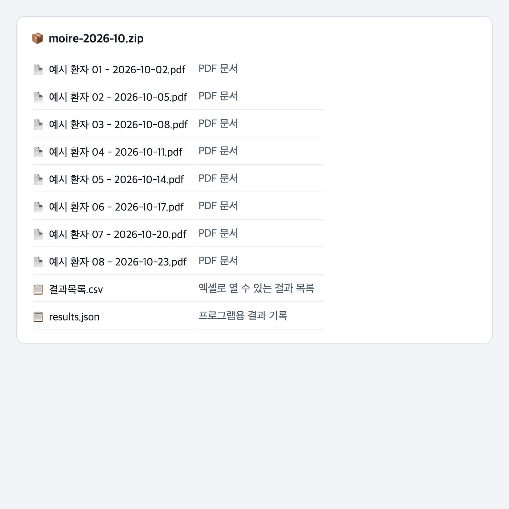

<p align="center"></p>

<h1 align="center">temo 딸깍</h1>

<p align="center"><b>아이밸런스 모아레 검사 리포트를 한 달 치 한꺼번에 PDF로 저장하는 크롬 확장 프로그램</b></p>

<p align="center">현재 버전 <b>v0.1.1</b> · <a href="CHANGELOG.md">변경 이력</a> · <a href="../../releases">다운로드(Releases)</a></p>

---

## 개발 이유

원장님들이 청구할 때 가장 번거로운 일 중 하나가 **검사 결과지 모으기**입니다. 한 달 동안 검사한 환자마다 리포트를 열고, 인쇄하고, 파일로 저장하는 일을 반복해야 합니다. temo 딸깍은 이 일을 버튼 한 번으로 줄이려고 만들었습니다.

한의계에서 새로운 수가를 발굴하는 것도 중요합니다. 그만큼 **이미 있는 수가를 잘, 그리고 많이 쓰는 것**도 중요하다고 생각합니다. 청구 준비가 쉬워지면 있는 수가를 더 적극적으로 활용할 수 있습니다.

> 이 프로그램은 회사 제품이 아닙니다. **주성수가 한의사로서 개인적으로 만든 버전**입니다.

## 목차

0. [개발 이유](#개발-이유)
1. [이 프로그램은 무엇인가요?](#1-이-프로그램은-무엇인가요)
2. [현재 버전(v0.1.1) 안내](#2-현재-버전v011-안내)
3. [준비물](#3-준비물)
4. [크롬 확장 프로그램 설치 방법](#4-크롬-확장-프로그램-설치-방법)
5. [사용 방법](#5-사용-방법)
6. [결과 ZIP 파일 구성](#6-결과-zip-파일-구성)
7. [문제가 생겼을 때](#7-문제가-생겼을-때)
8. [새 버전으로 업데이트하기](#8-새-버전으로-업데이트하기)
9. [안전과 개인정보](#9-안전과-개인정보)
10. [개발자용 안내](#10-개발자용-안내)

---

## 1. 이 프로그램은 무엇인가요?

병원 원장님이 **한 달 동안 진행한 모아레 검사 결과를 한꺼번에 제출**해야 할 때 쓰는 도구입니다.

아이밸런스에서 환자마다 리포트를 열고 인쇄 버튼을 눌러 PDF로 저장하는 일을, 버튼 한 번으로 대신합니다.

- 연도와 월만 고르면, 그 달에 검사한 **모든 모아레 검사의 공식 리포트**를 PDF로 만듭니다.
- PDF는 `환자이름 - 검사일.pdf` 이름으로 저장되고, **ZIP 파일 하나**로 묶여 다운로드 폴더에 저장됩니다.
- 함께 들어가는 `결과목록.csv`(엑셀로 열림)로 몇 건이 만들어졌는지 바로 확인할 수 있습니다.
- 이미 로그인된 아이밸런스를 그대로 사용하므로 **비밀번호를 다시 입력하지 않습니다.**

> 리포트 내용은 아이밸런스의 공식 인쇄 화면과 같습니다. 이 프로그램이 리포트를 새로 그리거나 바꾸지 않습니다.

## 2. 현재 버전(v0.1.1) 안내

2026-11-11 배포. 첫 공개 버전(v0.1.0)에 **3건 이상 실패 시 오류 기록 받기와 제보 안내**([7-1](#7-1-오류-제보하기-3건-이상-실패했을-때))를 더했습니다.

**할 수 있는 일**

| 기능 | 설명 |
|---|---|
| 월별 일괄 PDF | 선택한 달(한국 시간 기준 1일 0시 ~ 다음 달 1일 0시 전)의 모아레 검사 전부를 PDF로 저장 |
| 같은 환자 여러 검사 | 같은 환자가 한 달에 여러 번 검사했으면 각각 저장 (`홍길동 - 2026-10-30 (2).pdf`) |
| ZIP 한 개로 저장 | PDF 전부 + `결과목록.csv` + `results.json` |
| 실패 건만 다시 시도 | 일부가 실패하면 그 건만 다시 만들고, 성공한 PDF와 합친 ZIP을 다시 저장 |
| 자동 재시도 | 아이밸런스 인쇄가 가끔 시작되지 않는 문제를 감지해, 15초 간격으로 최대 3번 인쇄 버튼을 다시 누름 |
| 로그인 확인 | 아이밸런스에 로그인되어 있지 않으면 시작하지 않고 안내 |
| 오류 기록 받기 | 3건 이상 실패하면 버튼이 나타나 실패 사유를 텍스트 파일로 저장(환자 이름 제외). 오픈채팅으로 제보 |

**확인된 결과 (자체 테스트 · v0.1.0 기준)**

- 아이밸런스 테스트 서버에서 2026년 10월(환자 23명 · 모아레 검사 24건)을 **3회 연속 24건 모두 성공**했습니다. 한 번에 약 1분 20초 ~ 2분 20초 걸렸습니다.
- 기존 다운로드 프로그램으로 만든 PDF와 비교해 쪽수가 모두 같았고, 표지 쪽을 그림으로 비교했을 때 **픽셀까지 동일**했습니다.
- ZIP 파일은 무결성 검사(CRC)를 통과했습니다.

**참고**

- 크롬 웹스토어에는 아직 등록하지 않았습니다. 지금은 개발자 모드로 설치합니다.

## 3. 준비물

| 항목 | 내용 |
|---|---|
| 크롬 | Google Chrome 120 이상 (주소창에 `chrome://version`으로 확인) |
| 아이밸런스 | 이 크롬에서 아이밸런스에 로그인할 수 있는 계정 |
| 아이밸런스 주소 | 평소 아이밸런스를 여는 주소 (예: `http://192.168.0.10:3003/`) |
| 컴퓨터 시간대 | **한국 표준시(서울)**. 다르면 리포트 날짜가 틀어질 수 있어 시작하지 않습니다. |

## 4. 크롬 확장 프로그램 설치 방법

> 지금은 크롬 웹스토어에 등록하지 않은 버전이라 **개발자 모드**로 설치합니다. 처음 한 번만 하면 됩니다.

### 4-1. 파일 받기

1. 이 페이지 오른쪽의 **[Releases](../../releases)** 를 누릅니다.
2. 최신 버전(예: `v0.1.1`)의 **`temo-ttalkkak-v0.1.1.zip`** 을 내려받습니다.
3. 내려받은 ZIP 파일을 **더블클릭해서 압축을 풉니다.** `temo-ttalkkak-v0.1.1` 폴더가 생깁니다.
4. 이 폴더를 지우지 않을 위치(예: `문서` 폴더)로 옮겨 둡니다.
   크롬은 이 폴더에서 프로그램을 읽기 때문에, **폴더를 지우거나 옮기면 확장 프로그램이 동작하지 않습니다.**

### 4-2. 개발자 모드 켜기

1. 크롬 주소창에 `chrome://extensions` 를 입력하고 Enter를 누릅니다.
2. 오른쪽 위의 **개발자 모드** 스위치를 켭니다.



### 4-3. 압축 푼 폴더 불러오기

1. 개발자 모드를 켜면 왼쪽 위에 버튼 3개가 나타납니다. **압축해제된 확장 프로그램 로드**를 누릅니다.
2. 폴더 선택 창에서 4-1에서 압축을 푼 **`temo-ttalkkak-v0.1.1` 폴더**를 선택하고 **선택**을 누릅니다.
   (폴더 안에 `manifest.json` 파일이 보이는 폴더를 선택해야 합니다.)



### 4-4. 설치 확인

**temo 딸깍 0.1.1** 카드가 보이면 설치가 끝났습니다. 카드 오른쪽 아래 스위치가 켜져(파란색) 있어야 합니다.



### 4-5. 툴바에 고정하기 (권장)

1. 크롬 오른쪽 위 주소창 옆의 **퍼즐 모양 아이콘(확장 프로그램)** 을 누릅니다.
2. 목록에서 **temo 딸깍** 옆의 **핀(📌)** 을 누릅니다.
3. 주소창 옆에 파란 문서 모양의 temo 딸깍 아이콘이 고정됩니다. 다음부터는 이 아이콘만 누르면 됩니다.

## 5. 사용 방법

### 5-1. 아이밸런스에 로그인하기

같은 크롬에서 평소처럼 아이밸런스를 열고 로그인합니다. 로그인한 탭은 열어 둔 채로 두세요.

### 5-2. temo 딸깍 열기

툴바의 **temo 딸깍 아이콘**을 누르면 새 탭에 아래 화면이 열립니다.



### 5-3. 주소와 월 선택하기

| 칸 | 입력할 내용 |
|---|---|
| 아이밸런스 주소 | 평소 아이밸런스를 여는 주소. 한 번 입력하면 다음부터 자동으로 채워집니다. |
| 연도 / 월 | 제출할 달. 처음에는 지난달이 선택되어 있습니다. |

### 5-4. 시작하기

1. **PDF 만들기 시작**을 누릅니다.
2. **처음 한 번만** “이 사이트의 데이터 읽기 및 변경” 권한을 묻는 창이 뜹니다. **허용**을 누릅니다.
   이 권한은 입력한 아이밸런스 주소에만 적용되며, 리포트를 열고 PDF로 만들 때 필요합니다.
3. 작업이 시작되면 아래와 같은 일이 생깁니다. 모두 정상입니다.
   - **작업용 크롬 창**이 하나 더 열리고, 리포트 화면이 한 건씩 열렸다 닫힙니다.
   - 화면 위쪽에 **“temo 딸깍에서 이 브라우저 디버깅을 시작함”** 같은 노란 안내 막대가 나타납니다. 이 프로그램이 리포트를 PDF로 만들 때 표시되는 크롬 기본 안내입니다. **취소를 누르지 마세요.**

> **작업 중 주의**
> - 작업용 창을 닫지 마세요.
> - 끝날 때까지 아이밸런스 화면 사용을 잠시 멈춰 주세요. 아이밸런스에서 선택해 둔 환자가 바뀔 수 있습니다.
> - 검사 1건에 보통 3~6초 걸립니다. 한 달에 24건이면 약 1~2분입니다.

### 5-5. 진행 상황 보기

진행 상황 칸에 확인한 환자 수, 대상 검사 수, 성공·실패 수와 현재 만들고 있는 환자가 표시됩니다. 표에서 검사별 상태(완료 · 만드는 중 · 대기 · 실패)를 볼 수 있습니다.



멈추고 싶으면 **중지**를 누릅니다. 지금 만드는 1건을 마친 뒤 멈추고, 그때까지 성공한 PDF는 ZIP으로 저장됩니다.

### 5-6. 완료

모두 끝나면 **ZIP 파일이 다운로드 폴더에 자동으로 저장됩니다.**

- 전부 성공: `moire-2026-10.zip`
- 일부 실패: `moire-2026-10-partial.zip`



ZIP을 다시 받아야 하면 **ZIP 다시 저장**을 누릅니다(같은 이름이 있으면 `(1)`처럼 번호가 붙습니다).

### 5-7. 일부가 실패했을 때

실패한 검사는 표에 빨간 글씨로 이유가 표시됩니다. **실패한 검사만 다시 시도**를 누르면 실패한 건만 다시 만들고, 앞서 성공한 PDF와 합친 ZIP을 다시 저장합니다.



“로그인이 끝났습니다”로 실패했다면, 먼저 아이밸런스 탭에서 다시 로그인한 뒤 **실패한 검사만 다시 시도**를 누르세요.

### 5-8. 로그인이 안 되어 있을 때

아이밸런스에 로그인한 탭을 찾지 못하면 아래처럼 안내하고 시작하지 않습니다. 아이밸런스 탭이 없으면 로그인 화면을 새 탭으로 열어 줍니다. 로그인한 뒤 다시 **PDF 만들기 시작**을 누르세요.



## 6. 결과 ZIP 파일 구성



| 파일 | 내용 |
|---|---|
| `환자이름 - 검사일.pdf` | 아이밸런스 공식 리포트 PDF (A4). 같은 환자·같은 날짜가 여러 건이면 `(2)`, `(3)`이 붙습니다. |
| `결과목록.csv` | 번호 · 환자 · 검사일 · 결과(성공/실패) · 파일명 · 실패 사유. 엑셀로 바로 열립니다. |
| `results.json` | 같은 내용을 프로그램이 읽기 쉬운 형식으로 저장한 기록 |

- 검사일은 **한국 시간 기준 날짜**입니다.
- 파일 이름에 쓸 수 없는 문자(`/ \ : * ? " < > |`)는 `_`로 바뀝니다.
- 목록은 **아이밸런스 서버가 돌려준 환자·검사 목록 기준**입니다. 서버에서 조회되지 않는 검사는 포함될 수 없습니다.

## 7. 문제가 생겼을 때

| 화면에 보이는 문구 | 의미와 해결 방법 |
|---|---|
| 아이밸런스 로그인 상태를 찾지 못했습니다 | 같은 크롬에서 아이밸런스에 로그인한 뒤 다시 시작하세요. |
| 아이밸런스 로그인이 끝났습니다 | 로그인 시간이 끝났습니다. 아이밸런스에 다시 로그인하고 **실패한 검사만 다시 시도**를 누르세요. |
| 이 주소에 접근할 권한이 허용되지 않았습니다 | 권한 창에서 **허용**을 누르지 않았습니다. 다시 시작을 누르고 허용하세요. |
| 컴퓨터의 시간대가 한국 표준시가 아닙니다 | 시스템 설정에서 시간대를 **서울**로 바꾼 뒤 다시 시작하세요. |
| 아이밸런스 서버에 연결하지 못했습니다 | 주소가 맞는지, 병원 네트워크에 연결되어 있는지 확인하세요. |
| 공식 인쇄가 시작되지 않았습니다(3회 시도) | 아이밸런스 인쇄가 3번 모두 시작되지 않았습니다. **실패한 검사만 다시 시도**를 누르세요. |
| 작업 탭을 제어하지 못했습니다 | 작업용 창에서 개발자 도구(F12)가 열려 있거나 디버깅 안내 막대에서 취소를 눌렀습니다. 닫고 다시 시도하세요. |
| 작업 탭이 닫혔습니다 | 작업 중 작업용 창이나 탭이 닫혔습니다. 다시 시도하세요. |
| 선택한 달에 모아레 검사가 없습니다 | 그 달에 모아레 검사가 없습니다. 연도·월을 확인하세요. |

### 7-1. 오류 제보하기 (3건 이상 실패했을 때)

**3건 이상 저장되지 않으면** 진행 상황 아래에 **오류 기록 받기(.txt)** 버튼이 나타납니다. 실패가 2건 이하이면 버튼은 보이지 않습니다. 이때는 **실패한 검사만 다시 시도**를 먼저 눌러 주세요.

1. **오류 기록 받기(.txt)** 를 누릅니다. 다운로드 폴더에 `temo-ttalkkak-error-log-YYYY-MM-….txt` 파일이 저장됩니다.
2. 카카오톡 오픈채팅 **👉 [https://open.kakao.com/o/sqqaBBWi](https://open.kakao.com/o/sqqaBBWi)** 에 들어와 채팅을 걸어 주세요.
3. 받은 텍스트 파일을 채팅방에 보내 주시면 원인을 확인하겠습니다.

오류 기록 파일에 들어 있는 것: 확장 버전, 크롬 버전, 컴퓨터 시간대, 대상 월, 성공·실패 건수, 실패 사유와 단계(인쇄 버튼 클릭 횟수·걸린 시간 등), 진행 기록.
들어 있지 **않은** 것: 환자 이름, 검사일, 환자·검사 식별번호, 아이밸런스 주소. 혹시 오류 내용에 섞여 있으면 `[환자]`, `[주소]`, `[ID]`로 가려서 저장합니다.

> 화면 캡처나 `결과목록.csv`에는 환자 이름이 들어 있습니다. 오픈채팅에는 **오류 기록 텍스트 파일만** 보내 주세요.

## 8. 새 버전으로 업데이트하기

1. [Releases](../../releases)에서 새 버전 ZIP을 내려받아 압축을 풉니다.
2. 기존 `temo-ttalkkak-…` 폴더의 **내용을 새 폴더 내용으로 바꿉니다**(같은 위치에 덮어쓰기).
3. `chrome://extensions` 에서 temo 딸깍 카드의 **새로고침(↻)** 버튼을 누릅니다.
4. 카드에 새 버전 번호가 보이면 끝입니다.

> 폴더 위치를 바꿨다면, 기존 카드를 **삭제**한 뒤 4-3처럼 새 폴더를 다시 불러오세요. 입력해 둔 주소는 다시 입력해야 할 수 있습니다.

바뀐 내용은 [CHANGELOG.md](CHANGELOG.md)에 버전별로 정리합니다.

## 9. 안전과 개인정보

- **읽기 전용입니다.** 아이밸런스의 환자·검사 정보를 조회만 하고 수정·삭제·전송하지 않습니다. 리포트 화면에서 허용된 조회 외의 요청(저장, 전송, 로그아웃 등)은 차단합니다.
- **외부로 보내지 않습니다.** 환자 정보와 PDF는 이 컴퓨터의 크롬 안에서만 처리되고, 결과는 다운로드 폴더의 ZIP으로만 저장됩니다. 이 프로그램은 아이밸런스 서버 외의 어떤 서버와도 통신하지 않습니다.
- **비밀번호를 다루지 않습니다.** 이미 로그인된 아이밸런스 세션을 사용합니다. 다른 직원의 로그인을 끊지 않습니다.
- 확장 프로그램이 저장하는 것은 마지막에 입력한 **아이밸런스 주소** 하나뿐입니다.
- 오류 기록 파일(.txt)은 버튼을 눌렀을 때만 다운로드 폴더에 만들어지고, 자동으로 어디에도 전송되지 않습니다. 제보는 사용자가 직접 오픈채팅에 보낼 때만 이루어집니다.
- ZIP과 `결과목록.csv`에는 환자 이름이 들어 있습니다. 제출 후에는 병원 규정에 따라 보관·삭제해 주세요.

**필요한 권한과 이유**

| 권한 | 이유 |
|---|---|
| 디버거(`debugger`) | 리포트 화면을 공식 인쇄와 같은 방식으로 PDF로 만들기 위해 |
| 탭(`tabs`), 스크립트(`scripting`) | 로그인된 아이밸런스 탭을 찾고, 리포트 탭을 열고 닫기 위해 |
| 다운로드(`downloads`) | 완성된 ZIP을 다운로드 폴더에 저장하기 위해 |
| 저장소(`storage`) | 아이밸런스 주소를 기억하기 위해 |
| 사이트 접근(입력한 주소만) | 처음 시작할 때 묻습니다. 입력한 아이밸런스 주소에만 적용됩니다. |

## 10. 개발자용 안내

### 폴더 구조

```
extension/              크롬에 불러오는 확장 프로그램 본체 (Manifest V3)
  manifest.json
  app.html, app.js, app.css   화면과 전체 흐름
  sw.js                       툴바 아이콘 → 화면 열기
  lib/source.js               읽기 전용 GraphQL 조회, 월 범위, 파일명 규칙
  lib/report.js               리포트 1건 → PDF (chrome.debugger)
  lib/report-src.js           [생성 파일] 검사 선택·출처 확인·인쇄 캡처·요청 정책
  lib/zip.js                  무압축 ZIP 작성 (UTF-8 파일명)
  icons/                      아이콘
tools/
  build-report-src.cjs        report-src.js 재생성 (기존 다운로드 엔진에서 그대로 복사)
  make-icons.cjs              아이콘 재생성
  screenshots.cjs             README 캡처 재생성 (가상 데이터)
tests/
  e2e-source.cjs              별도 크롬 프로필에 설치 → 실제 아이밸런스로 끝까지 실행
  check-zip.py                ZIP 무결성·구성 검사 (환자명 출력 없음)
docs/images/                README 캡처
```

### 동작 순서

1. 로그인된 아이밸런스 탭의 `localStorage`에서 로그인 토큰을 읽습니다.
2. 아이밸런스 API(`<주소의 호스트>:8080/graphql`)로 환자 목록 → 환자별 검사 목록을 조회하고, 선택한 달의 모아레 검사를 고릅니다.
3. 검사마다 작업용 창에 리포트 탭을 열고 `chrome.debugger`로 연결합니다.
   공식 화면에서 해당 검사를 선택하고, 검사·환자가 맞는지 확인한 뒤, 공식 인쇄 버튼을 눌러 인쇄 화면을 캡처합니다.
   인쇄가 15초 안에 시작되지 않으면 최대 3번까지 다시 누릅니다.
4. 캡처한 인쇄 화면을 `Page.printToPDF`(A4, 여백 0)로 PDF로 만듭니다.
5. 모든 PDF와 결과 목록을 ZIP으로 묶어 `chrome.downloads`로 저장합니다.

### 테스트

```sh
# 실제 아이밸런스(테스트 서버 권장)로 끝까지 실행. 계정은 환경변수로만 전달하고 파일에 저장하지 않습니다.
MOIRE_URL=http://<host>:3003/ MOIRE_USER=<id> MOIRE_PASS=<pw> MOIRE_MONTH=2026-10 OUT=/tmp/temo-e2e \
  node tests/e2e-source.cjs
python3 tests/check-zip.py /tmp/temo-e2e/downloads/*.zip

# README 캡처·아이콘 재생성
node tools/screenshots.cjs
node tools/make-icons.cjs
```

`e2e-source.cjs`는 사용자 크롬이 아닌 임시 프로필을 쓰고, 끝나면 지웁니다. 권한 팝업 대신 테스트 주소에 호스트 권한을 미리 부여한 사본을 설치합니다.

### 릴리스 절차

1. `extension/manifest.json`의 `version`을 올립니다.
2. [CHANGELOG.md](CHANGELOG.md)에 변경 내용을 적습니다.
3. 테스트를 실행해 통과를 확인합니다.
4. `extension/` 폴더 내용을 `temo-ttalkkak-vX.Y.Z/` 폴더로 압축해 GitHub Release에 올립니다.
